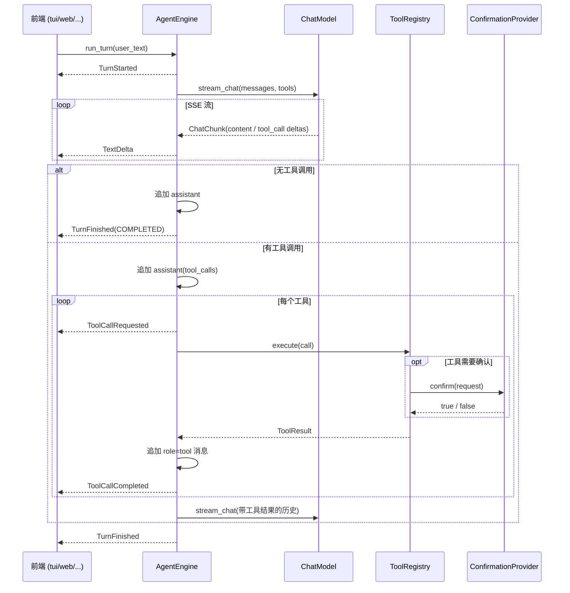
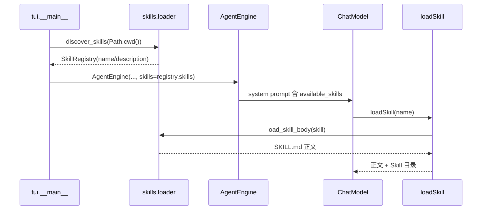

# Pulse 架构说明

本文面向需要维护 Pulse 或基于 `core` 开发新前端（Web、Desktop、Mobile）的开发者。

## 1. 分层与依赖规则

```
┌──────────────────────────────┐
│ tui/                         │  Textual 组件、Worker、Modal、样式
│  app.py / widgets/           │
└──────────────┬───────────────┘
               │ 只依赖 core 的公开契约
┌──────────────▼───────────────┐
│ core/                        │  不导入任何 UI 框架
│  agent / llm / tools /       │
│  session / events / config   │
└──────────────────────────────┘
```

强制规则：

- `tui` 可以导入 `core`，`core` **不得**导入 `tui`。
- `core` 不得导入 `textual`、`rich` 或任何界面框架。
- `core` 不得调用 `print()` / `input()`；所有输出通过事件或返回值传递。
- 事件只包含可序列化数据，方便 Web 前端直接转成 JSON。

`tests/test_core_is_ui_agnostic.py` 用 AST 扫描强制执行前两条规则。

## 2. 模块职责

| 模块 | 职责 | 依赖 |
| --- | --- | --- |
| `core/models.py` | `Message`、`ToolCall`、`ToolOutcome`、`ToolResult` | 无（叶子） |
| `core/prompts.py` | 系统提示词 | 无 |
| `core/errors.py` | `ConfigError`、`ToolError`、`LLMError` | 无 |
| `core/config.py` | `PulseConfig`、向上查找 `config.ini` | errors |
| `core/session.py` | 会话历史、`to_wire()` | models, prompts |
| `core/confirmation.py` | `ConfirmationProvider` 协议、AutoDeny/AutoApprove | 无 |
| `core/events.py` | 事件契约与 `TurnStatus` | models |
| `core/llm/base.py` | `ChatModel` 协议、`ChatChunk`、`ToolCallDelta` | models, tools.spec |
| `core/llm/openai.py` | OpenAI 兼容 SSE 客户端 | llm.base, errors |
| `core/skills/models.py` | `SkillMetadata`（name/description/路径） | 无（叶子） |
| `core/skills/registry.py` | Skill 名称索引、大小写回退、加载警告 | skills.models |
| `core/skills/loader.py` | 扫描 `.agents/skills/`；只读 frontmatter；按需读正文；解析并校验附件路径 | skills.models, skills.registry |
| `core/skills/prompt.py` | 把 Skill 目录注入系统提示词 | prompts, skills.models |
| `core/tools/spec.py` | `ToolSpec` 与 handler 类型 | models |
| `core/tools/context.py` | workspace 路径解析、确认网关 | confirmation, errors |
| `core/tools/registry.py` | 工具注册、schema 导出、异常归一 | spec, context |
| `core/tools/builtin/*` | 时间/闰年/文件/联网搜索/网页抓取/CLI 工具 | spec, context, httpx, trafilatura |
| `core/tools/builtin/skills.py` | `loadSkill`：按需读取 SKILL.md 正文或 Skill 内附件 | skills.loader, spec, context |
| `core/tools/defaults.py` | 装配默认 13 个工具；有 Skill 时追加 `loadSkill` | builtin, skills.registry |
| `core/agent.py` | `AgentEngine.run_turn()` 事件流 | 以上全部 |
| `tui/*` | 渲染事件、输入、确认、命令 | core |

### 为什么 `ToolSpec` 单独成模块

内置工具需要 `ToolSpec`，而注册表又需要导入内置工具。如果把 `ToolSpec` 放在注册表里，
就会形成 `registry -> builtin -> registry` 的循环导入。因此：

- `spec.py`、`context.py` 为叶子模块；
- 内置工具只依赖 `spec` / `context`；
- `defaults.py` 负责最后装配；
- `tools/__init__.py`、`llm/__init__.py` 保持为空，不做 eager re-export。

## 3. 事件流



事件类型（`core/events.py`）：

| 事件 | 含义 |
| --- | --- |
| `TurnStarted(turn_id, user_text)` | 一轮开始 |
| `TextDelta(turn_id, text)` | 助手文本增量 |
| `ToolCallRequested(turn_id, call_id, name, arguments, arguments_raw)` | 即将执行工具 |
| `ToolCallCompleted(turn_id, call_id, name, result)` | 工具执行完成（含失败/取消） |
| `ErrorOccurred(turn_id, message, detail)` | 模型或协议错误 |
| `TurnFinished(turn_id, status, content)` | 一轮终止：`completed/cancelled/error/max_rounds` |

不变量：

1. 每个 `TurnStarted` 恰好对应一个终止 `TurnFinished`。
2. `ErrorOccurred` 一定先于 `TurnFinished(ERROR)`。
3. `assistant(tool_calls)` 消息之后，每个 `call_id` 都有一条 `role=tool` 消息。
4. 流式中断或取消时，不提交半截 assistant 消息。

## 4. 会话与历史一致性

`Conversation` 只暴露只读快照，引擎负责在正确的时机追加消息：

| 失败点 | 历史结果 |
| --- | --- |
| 流式中途报错 | 只保留 user 消息，无半截 assistant |
| 流式中途取消 | 同上 |
| 工具批量执行中取消 | 已提交的 assistant(tool_calls) 后补齐剩余 `role=tool` 消息 |
| 工具抛异常 | 写入 `Error: ...` 的 tool 消息，回合继续 |
| 工具参数 JSON 非法 | 不执行工具，写入错误 tool 消息 |
| 达到最大轮数 | 以合法 tool 消息结尾，发出 `TurnFinished(MAX_ROUNDS)` |

## 5. 工具与确认

工具声明与实现放在一起：

```python
ToolSpec(
    name="deleteFile",
    description="...",
    parameters={...},          # OpenAI Function Calling JSON Schema
    handler=delete_file_handler,  # async (arguments, context) -> ToolOutcome
)
```

`ToolRegistry.execute()` 把任何异常归一为 `ToolResult(ok=False)`，因此单个工具失败
不会中断整轮对话。

`ToolContext` 提供：

- `resolve_path(path)`：相对路径基于 `workspace`，绝对路径保持原行为；
- `confirm(action, target)`：把确认请求交给当前 `ConfirmationProvider`；
- `search_api_key`：从 `PulseConfig` 注入，供 `searchWeb` 调用百度千帆
  AI 搜索 `web_search` API（`core/tools/builtin/web_search.py`）。该接口返回
  `references`（标题/URL/摘要），不再生成模型摘要。

前端实现确认协议的方式：

```python
class MyWebConfirmation:
    async def confirm(self, request: ConfirmationRequest) -> bool:
        await websocket.send_json({"type": "confirm", "request": asdict(request)})
        reply = await websocket.receive_json()
        return bool(reply["approved"])
```

CLI/测试环境可直接使用 `AutoDenyConfirmation` 或 `AutoApproveConfirmation`。

## 5.1 Skills 渐进式加载

Skill 遵循 Agent Skills 规范，采用三层渐进式加载：

| 层级 | 时机 | 内容 |
| --- | --- | --- |
| 1 | `main()` 启动 | 扫描 `<启动目录>/.agents/skills/*/SKILL.md`，只读 frontmatter 的 `name` / `description`，注入系统提示词 |
| 2 | 模型调用 `loadSkill(name)` | 读取完整 `SKILL.md` 正文（去掉 frontmatter）作为工具结果 |
| 3 | 模型调用 `loadSkill(name, filename)` | 读取 Skill 目录内的附件；精确路径优先，只给文件名时递归匹配 |



实现要点：

- `read_frontmatter()` 以二进制逐行读取，遇到结束 `---` 立即停止，**不读取正文**；
  因此正文损坏或极大都不影响初始化。
- frontmatter 解析只覆盖 Skill 需要的 YAML 子集（顶层键、引号、`|` / `>` 块标量），
  避免新增 PyYAML 依赖；嵌套键被忽略。
- 非法 Skill（缺少 `SKILL.md`、缺少 `name` / `description`、frontmatter 未闭合、
  名称重复）只记录到 `SkillRegistry.warnings`，不中断启动。
- 没有发现任何 Skill 时不注册 `loadSkill`，保持原有 13 个工具的定义不变。
- Skill 根目录固定为**启动时工作目录**；`--workspace` 只影响文件工具的路径基准，
  不改变 Skill 发现位置。
- `SkillMetadata` 只保存元数据与路径，注册表不缓存正文；每次 `loadSkill`
  都从磁盘读取，便于开发期间修改 Skill 后立即生效。
- 附件解析顺序为：绝对路径 → Skill 相对路径 → 项目相对路径 → 仅文件名递归匹配。
  每个候选都先 `resolve()` 再校验 `is_relative_to(skill_dir)`，因此 `..` 与指向
  目录外部的符号链接都无法绕过范围限制。
- 同名文件有多个时，`loadSkill` 返回 Skill 相对候选路径，由模型选择后再次调用；
  不会擅自挑选其中一个。

动态加载不变量：

1. 初始化后，`SkillMetadata`、System Prompt 与 tools schema 都不包含 `SKILL.md` 正文；
2. 正文只在 `loadSkill` 成功执行后，作为 `role=tool` 消息写入 `Conversation`；
3. `loadSkill` 不改变引擎循环：它和 `RunCli`、`readTextFile` 一样是普通
   `ToolSpec`，同一轮可混合调用，并继续满足“assistant(tool_calls) 之后每个
   call_id 都有一条 tool 消息”的历史一致性约束。

## 6. LLM 客户端

`ChatModel` 协议只有 `stream_chat(messages, tools)`，返回 `ChatChunk` 异步迭代器。
`OpenAIChatClient` 负责：

- 构造 `/chat/completions` 请求体（含 `tools` envelope）；
- 解析 SSE `data:` 行与 `[DONE]`；
- 把非 2xx 响应转换为 `LLMError(status, body)`。

**不负责**拼接分片 tool_call，这由 `AgentEngine._merge_tool_delta()` 完成，便于用
FakeChatModel 精确模拟分片。

## 7. 新增前端（以 Web 为例）

```
Agent/Pulse/
├── core/        # 不变
├── tui/         # 不变
└── web/         # 新增
    ├── server.py        # FastAPI/Flask，持有 AgentEngine
    ├── confirmation.py  # 基于 WebSocket 的 ConfirmationProvider
    └── static/          # 前端页面
```

步骤：

1. 读取 `PulseConfig`，创建 `OpenAIChatClient`；用
   `discover_skills(Path.cwd())` 发现 Skill，再调用
   `build_default_registry(workspace, search_api_key=config.search_api_key,
   skills=skills)`。
2. 把 registry 的 `confirmation` 换成本前端的实现。
3. 每个会话创建一个
   `AgentEngine(model, registry, skills=skills.skills, ...)`，使系统提示词包含
   Skill 目录；前端可另外展示 `SkillRegistry.warnings`。
4. 把 `engine.run_turn(text)` 的事件转换为 WebSocket/SSE 消息。
5. 前端渲染 `TextDelta`、`ToolCallRequested`、`ToolCallCompleted`、`ErrorOccurred`；
   收到 `TurnFinished` 结束本轮。

建议把事件转换为纯 JSON（dataclass → dict），不要直接序列化 `ToolResult` 以外的对象；
后续如需统一格式，可在 core 增加一个只依赖标准库的 `to_dict()` 辅助函数。

## 8. 不变式与测试策略

- 所有 core 测试使用 `FakeChatModel` 和临时目录，不访问网络、不依赖 Git Bash。
- SSE 解析测试使用 `httpx.MockTransport`，可以精确控制分片与错误状态码。
- TUI 测试使用 `App.run_test()` + `Pilot`，覆盖流式渲染、工具卡片、确认框、
  取消与斜杠命令。
- `test_core_is_ui_agnostic.py` 防止后续提交把界面依赖带进 `core`。

## 9. Windows 注意事项

- 使用 Python 3.13 默认的 Proactor 事件循环即可；`getdate` 通过 `asyncio.to_thread`
  执行子进程，不阻塞事件循环。
- `date` 命令按 PATH → Git for Windows 安装目录 → `bash -c date` 顺序回退。
- 读取配置使用 `utf-8-sig`，读取文本文件依次尝试 `utf-8-sig`、`gbk`。
- `fetchWeb` 通过 `subprocess.run([...])` 调用 `curl`（参数列表、不使用 `shell=True`），
  下载与 trafilatura 解析都在 `asyncio.to_thread` 中执行，不阻塞事件循环。
- `RunCli` 同样使用参数列表与 `shell=False`，在 `asyncio.to_thread` 中执行，
  stdin 接 `DEVNULL`、30 秒超时、输出截断；本阶段不提供白名单或审批。
- 工具输出在界面中截断到约 8000 字符，且使用 `markup=False`，避免大文件或
  Rich markup 影响终端。
- 相对路径以状态栏显示的 workspace 为基准；从 `Agent/Pulse` 启动时默认为该目录，
  如需操作其他目录请使用 `--workspace`。
